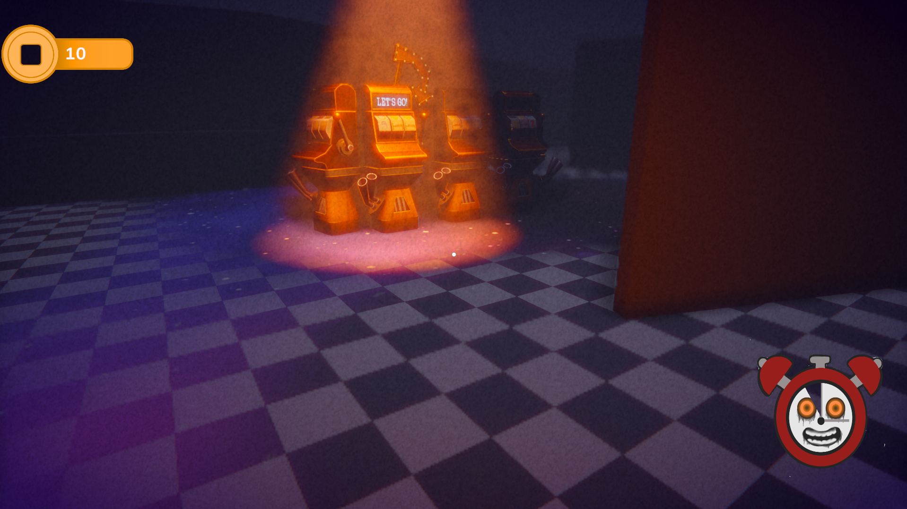
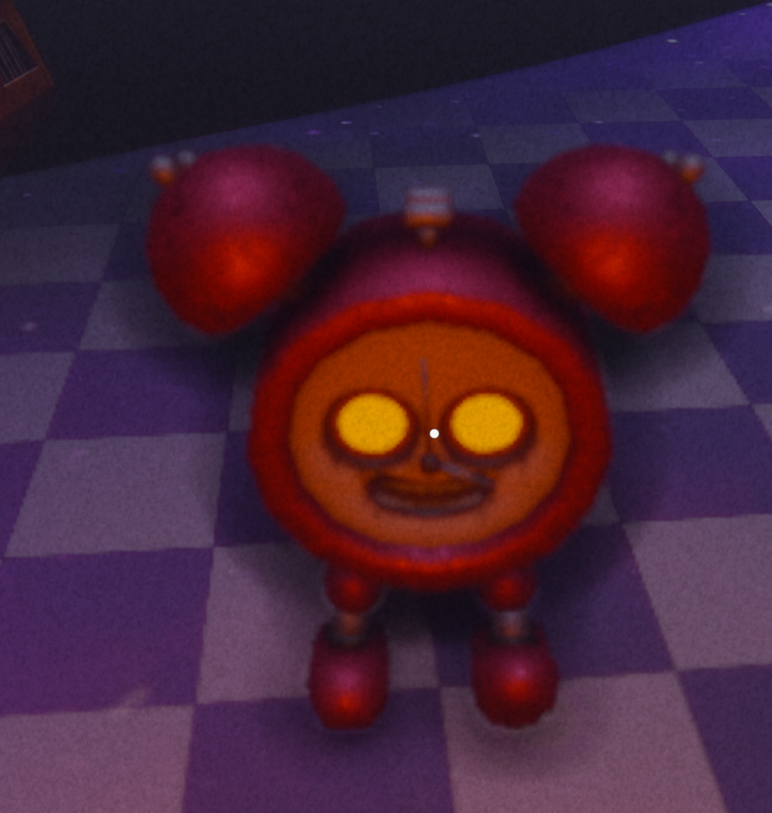
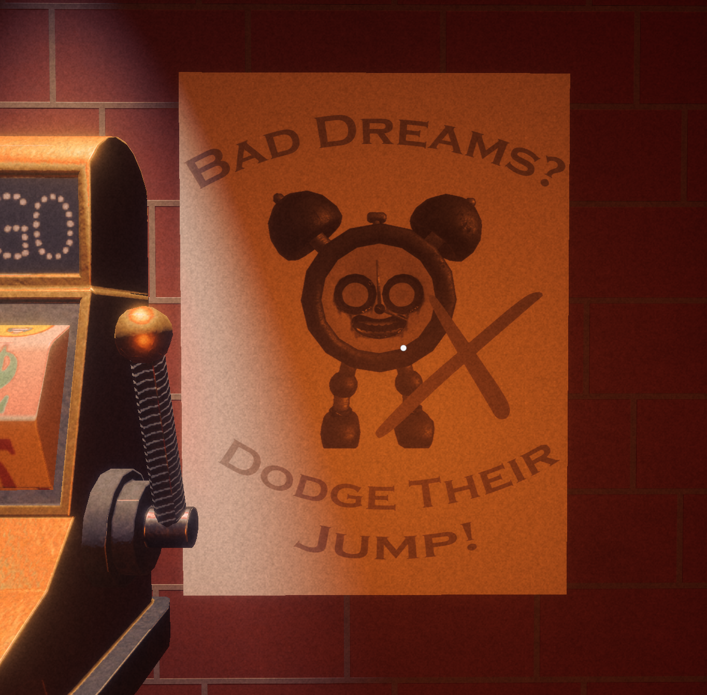
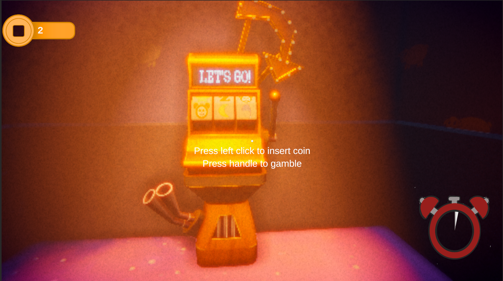
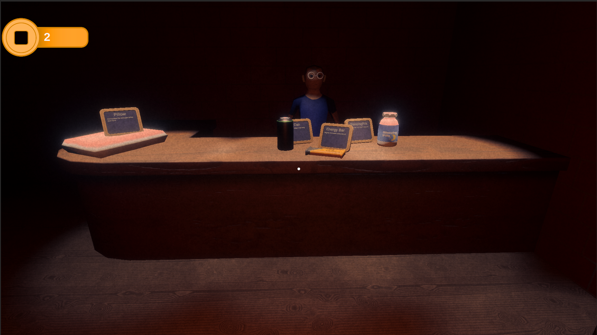

# Gambler's Dream
Gambler's Dream is a game that was made in 49 hours in the Leuven Best gamejam.

***
 
### The Team:  
- [**Pepijn Vanhumbeeck**](https://www.linkedin.com/in/pepijn-vanhumbeeck-861a1336b/)  
- [**Hannes Malfait**](https://www.linkedin.com/in/hannes-malfait-5467a3364/)  
- [**Rhune Beeckmans**](https://www.linkedin.com/in/rhune-beeckmans-6a829538b/)  
- [**Loic Gouwy**](https://www.linkedin.com/in/lo%C3%AFc-gouwy-65113a391/)  
- [**Mattias Simonts**](https://www.linkedin.com/in/mattias-simonts-4552023a0/) 

***

[Link To Itch.io](https://mattiassimonts.itch.io/gamblers-dream)

***  
### **lore:**
Yesterday I went completely broke. Lost every last penny on that damn slot machine. I can't ever seem to win on these damn things. But there is one place where I always win...

Dive deep in to the world of gambling where you can explore the dreams of John Gamble and gamble your debt away!

Run slot machines, collect the coins, wake up, buy upgrades and repeat!

Check out this state of the art gambling roguelike!
***
### Pictures:

***
### Techical Specs
This game was made with the [Unity](https://unity.com/) engine using version 6000.3.24f1

